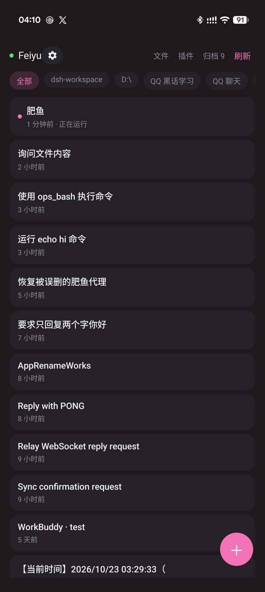
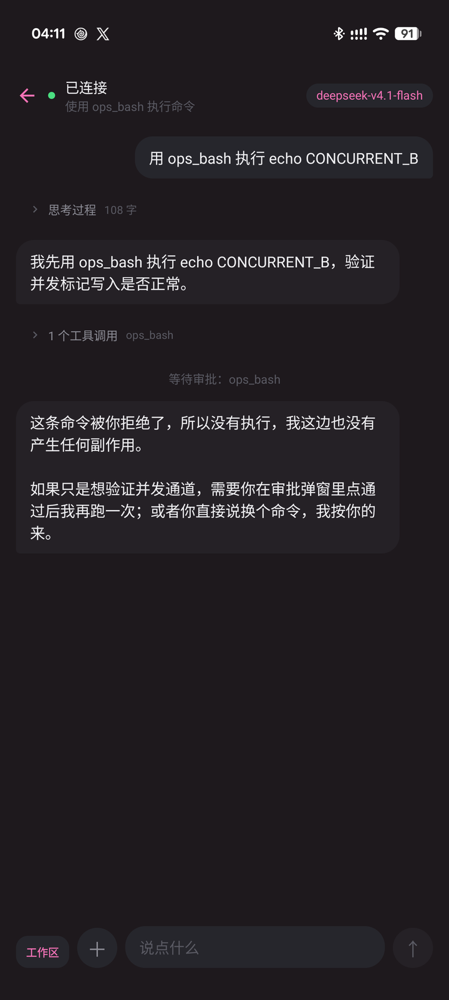
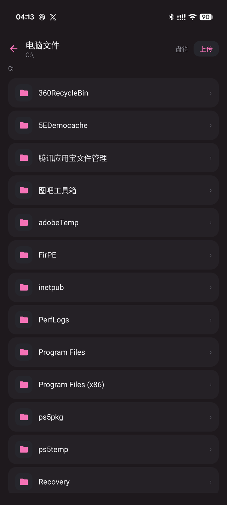
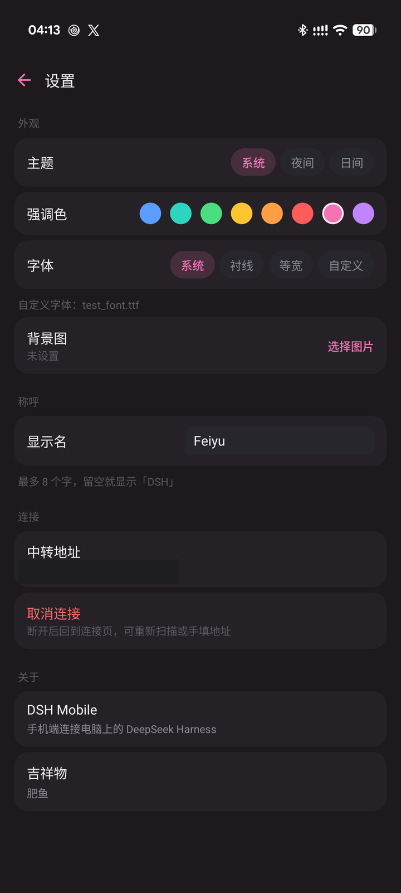
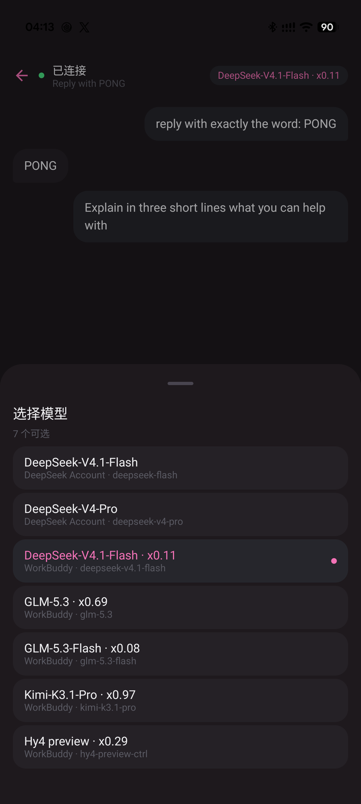

# 点击肥鱼

> 把电脑上的 [DeepSeek Harness (DSH)](https://deepseek.com) 完整带到你的 Android 手机上。

**不是投屏，更不是 WebView 网页套壳**。这是一个专为 DSH 打造的**原生安卓客户端**（基于 Kotlin + Jetpack Compose），与电脑端镜像同一个会话。
你在电脑上发起的话题，躺在沙发上用手机能接着聊；手机上回复的一条消息，电脑屏幕上立刻刷新。

<p align="center">
  
</p>

---

## 为什么不用手机浏览器直接开？

DSH 桌面版默认只监听 `127.0.0.1`（回环地址），手机在局域网内本来就访问不到。就算想办法打通这一层，在手机浏览器里你依然要面对以下几座大山：

| 体验维度 | ❌ 手机浏览器直接访问 | ⚓️ 本项目（点击肥鱼） |
| :--- | :--- | :--- |
| **跨设备访问** | 连不上（只绑回环地址） | 通过中转桥接（Relay）开放给局域网 |
| **安全性** | 谁扫到端口都能连，没有任何鉴权 | 强制校验 `x-relay-key`（32 位密钥） |
| **Origin 校验** | 403 拒绝访问 | 中转改写 Origin 来源 |
| **WebSocket** | 401 鉴权失败，界面永远卡在“正在加载” | 中转自动补全 Cookie |
| **界面操控** | 桌面布局挤在 6 寸屏上，字小难点 | 为手指重排的原生界面 |
| **多会话同步** | 每次打开可能另起一份 | **真正的镜像会话**，多端同步 |
| **流畅度** | 长列表滚动发涩 | 原生 `LazyColumn`，配合原生转场 |

---

## 🚀 快速开始

### 1. 电脑端（中转与插件）

> **前置要求**：需要 Node.js 18+ 以及 [DSH 桌面版](https://github.com/deepseek-ai)。

1. **下载并解压**

   在页面右上角点 `Code` → `Download ZIP`，解压到任意位置。不用装 git，放哪儿都行。

2. **安装插件**

   双击解压出来的 `dsh-relay-plugin\install.cmd`。它会按自己的位置找路径，不用你填任何东西。

   它做两件事：把依赖写进 profile 的 `package.json`，再把插件名加进 `dsh.profile.bundles`。
   只加依赖是不行的——DSH 加载哪些 bundle 看的是后者，`dsh plugin add` 那条命令只做前半步。
   跑完会提示重启 DSH。

3. **确认启用**：
   打开 DSH 的「插件页」，此时会出现「点击肥鱼 · 中转」插件。在详情页中，你可以修改监听地址、端口、自动重启策略，并查看自动生成的**访问密钥**。

⚠️ **避坑指南**：中转服务已集成在插件中，会随 DSH 一起自动启动。**请勿手动在终端使用 `node` 启动它**。两边如果抢占 `8090` 端口，会直接触发 `EADDRINUSE` 报错，导致“端口被占用但界面显示已停止”的尴尬。

### 2. 手机端

**直接装**：下载 [release/feiyu-1.0.apk](release/feiyu-1.0.apk)，传到手机上安装即可（需要允许「安装未知来源应用」）。

**自己编译**（可选，需要 Android Studio）：

```
cd dsh-mobile
./gradlew :app:installDebug        # bash / macOS / Linux
gradlew.bat :app:installDebug      # Windows cmd
```

**首次打开**，在「连接」页填两项：

- **电脑地址**：中转启动时控制台会打印，形如 `http://192.168.1.100:8090`；也可以在电脑浏览器打开 `http://<电脑IP>:8090/` 看状态页
- **访问密钥**：插件详情页里能看到，或者直接看电脑上的 `~/.dsh/dsh-relay/key.txt`

填对了就会进会话列表；填错会提示「访问密钥不对」，不会静默卡住。

---

## 看看长什么样

<p align="center">
  
  
  
</p>
<p align="center">
  
  
</p>

> 设置页那张把中转地址涂掉了，其余都是直接截的。

## ✨ 核心特性

### 📱 匠心打磨的原生界面

拒绝粗糙的组件堆砌，我们为原生操作体验做了大量细节优化：

*   🎨 **色彩深入底色**：支持跟随系统、夜间、日间三档，并内置 **8 套强调色**。切换主题色时，整个界面的氛围（不仅仅是按钮）都会自然融入，绝不突兀。
*   ✍️ **字体与背景自定义**：字体支持系统、衬线、等宽及 **自定义 ttf 字体**。支持设置半透明 PNG 背景，提供模糊度和浓度两档微调。
*   🖤 **深色克制美学**：界面完全摒弃了在低端机上容易掉帧、在大屏上破坏对比度的“卡片阴影 + 毛玻璃边框”。仅通过字号、间距和卡片色差区分层级，确保长对话快速滑动时依然稳。
*   📐 **图标一致性**：全部使用定制的矢量图标（Vector Drawables），不依赖 emoji，在各品牌 ROM 上表现一致。
*   🚀 **无感手势**：会话列表与聊天页之间支持滑动穿梭，左滑归档自带 5 秒防误触撤回。

### 💬 真正的镜像会话 (Chat)

*   **双端无缝同步**：随时随地接力电脑端的对话历史与上下文。
*   **实时流式（Stream）响应**：Token 逐字蹦出，不是等全部算完才刷新。
*   **优雅的 Markdown 渲染**：支持富文本、列表、引用，代码块支持语法高亮，表格自适应移动端宽度。
*   **高效信息折叠**：
    *   工具调用（Tool Calls）折叠为一行，默认收起，点开才看参数和结果。
    *   思考过程（Thinking）默认收起，点击即阅，不让冗长思考霸占宝贵的屏幕空间。
*   **移动端审批（Approvals）**：DSH 执行高危操作（如运行本地命令）时发起的审批，直接在手机卡片上“一键同意 / 拒绝”。
*   **多工作区支持**：新建会话时可直接选择工作区（Workspace），无需为了开个新话题跑回电脑前。

### 📂 完整的远程文件管理器 (File Manager)

*   **全局浏览**：不用通过对话，随时查看电脑上的文件目录。
*   **一键传输**：支持浏览、下载电脑文件，也能把手机本地图片、文档直接传给电脑。
*   **跨盘符访问**：对 Windows 用户友好，C/D/E 等多分区自由切换。

---

## 🔒 安全说明

没有密钥的话，局域网里任何人只要扫描 `8090` 端口就能读取你的电脑文件、接管你的会话。
因此项目默认强制启用 **Access Key 鉴权**：

1. 首次启动时，中转会在 `~/.dsh/dsh-relay/key.txt` 随机生成一串 32 位密钥。
2. 手机端连接时必须填入此密钥。
3. 除了 `/relay/ping`（用于局域网自发现，仅响应版本及端口号）之外，**所有请求都必须携带 `x-relay-key`**，否则直接阻断。
4. 密钥也可以手动修改，改完重启中转即可生效。

---

## 🏗️ 项目架构

```
┌─────────────┐            ┌──────────────┐            ┌───────────────────┐
│  手机 App    │  ────────▶  │ 中转 (Relay)  │  ────────▶  │ DSH 桌面版         │
│  Kotlin     │   局域网内   │ Node.js      │   本机内网   │ 127.0.0.1:<随机>   │
│  (Compose)  │   :8090      │ (0.0.0.0)    │   (Loopback) │                   │
└─────────────┘            └──────────────┘            └───────────────────┘
```

*   `dsh-mobile/`：基于 Jetpack Compose 的 Android 原生客户端。
*   `dsh-mobile/relay/`：中转服务的核心实现。
*   `dsh-relay-plugin/`：DSH 插件，把中转的生命周期绑到 DSH 上，实现自动启停与重启。

---

## ⚠️ 已知限制与避坑

1. **必须在同一局域网**：中转绑定 `0.0.0.0`，需要手机与电脑能互相路由。想在户外用，得自己配内网穿透（tailscale、frp 之类）。
2. **流量不加密**：中转走明文 HTTP/WS，密钥也是明文，请只在可信的家庭 / 办公局域网里用。
3. **依赖 DSH 桌面版常驻**：电脑关机或 DSH 没开就连不上。
4. **Android 版本限制**：最低 Android 12（API 31）。低版本上「自定义背景图模糊」不生效，其他功能正常。

---

## 📄 开源许可

本项目基于 **MIT** 协议开源，详情请参阅 `LICENSE`。
